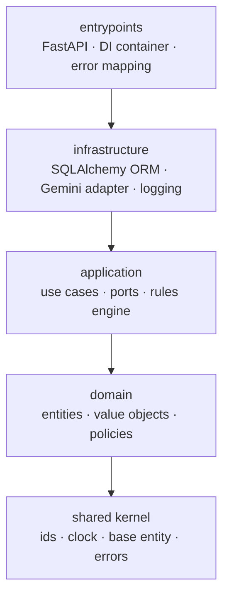

# Annexa

**EU AI Act compliance-as-code.** Annexa helps engineering teams find the AI systems in their codebase, classify them under the EU AI Act, and work out which obligations apply and by when, with an audit trail behind every decision.

> **Status: early development, built in public.** The foundations below are working and tested; the assessment workflow is in progress. See the [roadmap](#roadmap).
>
> **Not legal advice.** Annexa is an engineering tool. Its rule packs are illustrative and must be reviewed by qualified counsel before being relied on.

## Why

Companies shipping AI features in the EU now need to know, per system: what role they play (provider, deployer, ...), which risk tier the system falls into, and which articles they must comply with by which date. Today that lives in spreadsheets that drift from the code. Annexa treats it like any other engineering concern: discovered from source, versioned, testable, and enforced in CI.

## What works today

| Area | What's implemented |
| --- | --- |
| **AI discovery (CLI)** | `annexa-scan` walks a Python codebase with the `ast` module and detects AI SDK usage (OpenAI, Anthropic, LangChain, LangGraph, Transformers, ...). Outputs a table or a CycloneDX 1.6 AI-BOM. Ships as its own package so it can run in CI without the platform. |
| **Obligations engine** | Versioned YAML rule packs, validated strictly with Pydantic. Obligations are evaluated **deterministically** from the system's role and risk tier, so the same inputs always give the same answer. No LLM in this path. |
| **AI system register** | `AISystem` aggregate with a guarded lifecycle: `draft → in_review → approved → stale → retired`. Invalid transitions raise domain errors. |
| **Ask-the-Act** | Authenticated `POST /ask-the-act` streaming answers over Server-Sent Events, behind an `LLMProvider` port (Gemini adapter). Storage for the Act's text with pgvector embeddings is in place; grounding answers in retrieved articles is next. |
| **Identity & tenancy** | Tenants, users and five roles (owner, admin, compliance officer, engineer, auditor). JWT access tokens, Argon2 password hashing, role policies, tenant context propagated per request. |
| **Platform** | FastAPI with a DI container, RFC 9457 `problem+json` errors, structured JSON logging, async SQLAlchemy 2.0 with Unit of Work, Alembic migrations, PostgreSQL 17 + pgvector. |

## Architecture

Hexagonal (ports and adapters), organised by bounded context. The layer rules aren't just a convention: they're enforced on every run by an [import-linter](https://github.com/seddonym/import-linter) contract, so the domain can never import infrastructure.



Bounded contexts: `identity`, `inventory`, `regulation` and `rules`, plus a `shared` kernel. An `assessment` context (the review workflow) is in progress.

```
src/annexa/          FastAPI platform (uv workspace root)
packages/
  annexa-scanner/    standalone AST scanner CLI
rulepacks/           versioned YAML obligation packs
migrations/          Alembic migrations
tests/               unit + integration tests
```

### Key design decisions

- **Rules decide, the LLM explains.** Which obligations apply is computed by a deterministic, testable rules engine. The LLM is only used for discovery and Q&A, never to make the compliance decision itself.
- **Boring storage.** Embeddings live in PostgreSQL with pgvector rather than a separate vector database: one system to back up, secure and reason about.
- **Long-running reviews don't hold connections.** Human review steps pause the LangGraph workflow and resume later from persisted state, instead of keeping an HTTP request open (in progress).
- **Errors are a contract.** Domain errors map to RFC 9457 problem details with stable error codes.

## Quickstart

Requirements: [uv](https://docs.astral.sh/uv/), Docker, Python 3.13.

```bash
docker compose up -d                 # PostgreSQL 17 + pgvector
cp .env.example .env                 # add your GEMINI_API_KEY
uv sync
uv run alembic upgrade head
uv run uvicorn annexa.entrypoints.api:app --reload
```

API docs: http://localhost:8000/docs

Scan a codebase for AI components:

```bash
uv run annexa-scan scan ./path/to/project               # table
uv run annexa-scan scan ./path/to/project --format json # CycloneDX AI-BOM
```

## Quality gates

```bash
uv run pytest        # unit + integration tests
uv run mypy          # strict mode
uv run lint-imports  # architecture contract
```

## Roadmap

- [x] Workspace, shared kernel, composition root and API
- [x] Database, migrations, observability and config
- [x] Tenants, roles, authentication and authorization
- [x] AI system register and lifecycle
- [x] AST scanner CLI with CycloneDX AI-BOM output
- [x] Regulation storage, embeddings and Ask-the-Act streaming endpoint
- [x] Deterministic obligations engine and rule packs
- [ ] Assessment workflow with human-in-the-loop review (LangGraph)
- [ ] Telemetry SDK for runtime evidence (`annexa-sdk`)
- [ ] Immutable, hash-chained evidence ledger
- [ ] Background jobs with the transactional outbox pattern (Celery)
- [ ] GitHub webhooks to flag compliance drift on new commits
- [ ] Document generation and an MCP server
- [ ] Dashboard and evaluation suite

## License

[Apache License 2.0](LICENSE).

## Author

Built by [Aymen Hammami](https://aymen-hammami.com), senior backend engineer. Feedback and issues are welcome.
